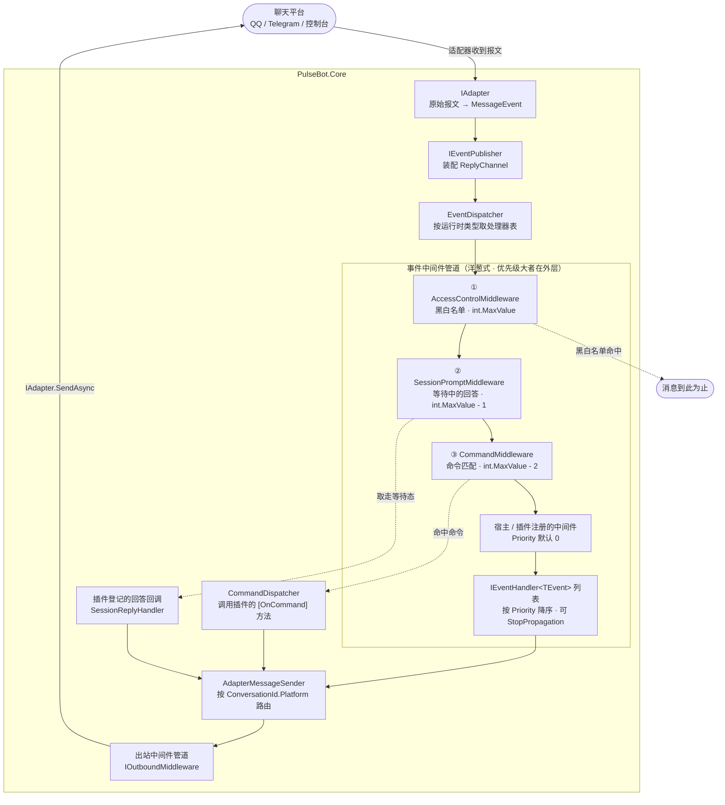

# PulseBot

事件驱动、**适配器 + 插件**架构的 C# 聊天机器人框架。基于 .NET 10 / C# 14。

插件只接触平台无关的抽象（事件、消息段、命令上下文），完全不感知 QQ、Telegram 之类的协议细节；
适配器把某个平台的原始报文翻译成统一事件与消息段，核心不反向依赖任何适配器。

## 特性

- **事件驱动** — 所有事件实现 `IEvent`，由 `EventDispatcher` 按优先级分发给处理器，支持 `StopPropagation` 阻断传播。
- **中间件管道** — 三处洋葱式挂载点（优先级大者在外层，可前处理、改写载荷、后处理、不调续延即短路）：**事件分发链**（接入控制与会话拦截装在这里，不在处理器列表里参与排序）、**消息发送前后**（限流防刷、敏感词过滤、统一前缀、发送审计）、**插件加载与卸载前后**（加载审计、按配置禁用插件、失败补偿）。
- **命令系统** — `[OnCommand("天气")]` 标注即注册，支持别名、无前缀命令、命令名冲突优先级、命令级权限节点。
- **交互会话** — 插件可提问，用户的下一条消息自动路由回该插件，支持多轮、超时与取消，并带一个可跨命令读写的键值状态袋。粒度为 *(会话 + 用户)*：同一群里每人独立。
- **权限与接入控制** — 用户/群黑白名单、超级管理员、`RequirePermission` 组合规则，接入控制位于事件管道最前端。
- **定时任务** — 任务实现 `IScheduledTask`，用固定间隔或 Cron（5 段 / 含秒 6 段）声明触发方式；调度器串行执行并记录执行历史，带分布式锁，存储与锁都可替换为持久化实现。
- **消息段抽象** — 文本、图片、@、回复引用、表情；基类是刻意不密封的 `abstract record`，适配器可自行派生平台专属段。
- **热路径零反射** — 命令处理器在启动时扫描一次并通过 `CreateDelegate` 编译为强类型委托并缓存，分发路径上没有 `MethodInfo.Invoke`。
- **全异步 + 构造函数注入** — 所有 I/O 返回 `Task`/`ValueTask` 并传播 `CancellationToken`，服务一律通过 DI 构造。

## 当前状态

| 项目 | 状态 |
| --- | --- |
| `PulseBot.Core` | ✅ 已实现 — 事件分发、命令、权限、插件、交互会话、定时任务、消息段 |
| `PulseBot.Cli` | ✅ 已实现 — 宿主入口、DI 装配、生命周期协调 |
| `PulseBot.Adapter.Console` | ✅ 已实现 — 把标准输入输出当作聊天平台，用于本地联调与新适配器的参考实现 |
| `PulseBot.Plugins.Echo` | ✅ 已实现 — 示例插件（单轮命令 + 多轮对话两种形态） |
| `PulseBot.Adapter.OneBot` | ✅ 已实现 — OneBot 12 反向 WebSocket（消息、通知、请求事件） |
| `PulseBot.Admin.*` | ✅ 已实现 — 同进程后台：JWT 认证、账号与密码管理、登录限流、状态查询、插件启停、权限名单热更新、审计落库、SignalR 实时推送；Vue 前端待做 |

测试：350 个（Core 193 + Console 12 + OneBot 29 + Admin 116），`dotnet test` 全绿。

> 也就是说，**开箱即可在控制台里跑通完整闭环**（发消息 → 事件管道 → 命令 → 回话）；接入真实平台用 `PulseBot.Adapter.OneBot`，它已实现 OneBot 12 反向 WebSocket 与消息、通知、请求三类事件的翻译。

## 环境要求

- [.NET 10 SDK](https://dotnet.microsoft.com/download)（目标框架 `net10.0`，语言版本 C# 14）
- Node.js 仅在开发后台前端时需要（`PulseBot.Admin.Web` 尚未创建）

```bash
dotnet --version   # 应输出 10.x
```

## 快速开始

```bash
git clone https://github.com/ALNthy/PulseBot.git
cd PulseBot
dotnet run --project src/PulseBot.Cli
```

宿主同时会在 `http://localhost:5187` 挂载后台管理接口（JWT 认证、监控、插件与权限写操作、实时推送，见[后台管理](#后台管理)）；只想跑机器人，把配置里的 `Admin:Enabled` 设为 `false` 即可。

启动后会出现 `你> ` 提示符，直接输入即可：

```
你> /echo 你好
机器人> 你好

你> /注册
机器人> 请输入你的昵称（发送 /cancel 放弃）
你> 小明
机器人> 你好，小明！
你> /我是谁
机器人> 你是 小明。
```

控制台适配器还有几个**本地指令**（在适配器内部消化，不会发给机器人）：

| 指令 | 作用 |
| --- | --- |
| `:help` | 查看本地指令 |
| `:session` | 显示当前会话 |
| `:switch private` / `:switch group <群号>` | 切换当前会话（用于验证「同一群里每人独立」） |
| `exit` | 结束输入（机器人继续运行，Ctrl+C 退出宿主） |

## 事件驱动原理

一条消息从进入框架到机器人回话，全程只有「一次查表 + 若干次委托调用」，没有任何反射。下图是完整闭环——**中间件管道与处理器列表是所有插件共用的一条链**：



**① 三档内建中间件的顺序由优先级数值保证，与注册顺序无关。** 接入控制在最外层，被拉黑的人根本没有机会进入后续任何环节；会话拦截居中，等待回答期间用户说的话优先当作「回答」而不是命令——否则在无前缀命令默认开启时，「复读 你好」这种恰好以命令名开头的回答会被命令分发夺走，插件永远收不到答案且没有任何报错；命令分发最靠内，排在宿主与插件注册的普通中间件之外。

**② 短路有两种形式，效果都是「后面的都不执行」。** 中间件不调用续延 → 整条链（含处理器列表）终止；处理器调用 `EventContext.StopPropagation()` → 只阻断同批次后续处理器。内建三档用的都是前者：接入控制拦截、会话拦截截获回答、命令分发命中命令，都不会再往下走。

**③ 出站是一条独立的管道，与入站共享同一个「平台」端点。** 插件回复时消息并不原路返回，而是走 `AdapterMessageSender`——它按 `ConversationId.Platform` 查适配器路由表，中途经过出站中间件管道，可以改写消息或阻断发送。

**④ 适配器与发送器之间的构造期循环依赖，靠「延迟解析」断开。** 适配器需要 `IEventPublisher` 发布事件，而 `AdapterMessageSender` 需要全部适配器来建立路由表；若在构造期互相解析，容器会直接拒绝解析。所以 `EventPublisher` 接收的是 `Func<IMessageSender>` 工厂，推迟到「首次发布事件」时才解析——那时容器已构建完毕，适配器实例也已在位。

**⑤ 没装中间件时走零分配快路径。** 管道在构造期一次性绑定为委托链，运行期不再碰容器；既没装中间件又没有匹配处理器时，分发以 `ValueTask.CompletedTask` 直接返回。

完整实现见 [Dispatching/](src/PulseBot.Core/Dispatching/)、[Permissions/AccessControlMiddleware.cs](src/PulseBot.Core/Permissions/AccessControlMiddleware.cs)、[Sessions/SessionPromptMiddleware.cs](src/PulseBot.Core/Sessions/SessionPromptMiddleware.cs)。

## 搭一个宿主

框架的全部能力都由 DI 容器拼装，宿主入口只负责「登记」。以下是 Cli 的完整装配（见 [`Program.cs`](src/PulseBot.Cli/Program.cs)），搭自己的宿主时逐段照抄即可：

```csharp
WebApplicationBuilder builder = WebApplication.CreateBuilder(new WebApplicationOptions
{
    Args = args,
    ContentRootPath = AppContext.BaseDirectory,
});

// 内核：事件、分发、命令、插件、会话、权限、调度
builder.Services.AddPulseBot();

// 配置绑定：没有这一步，appsettings.json 里对应节的内容不会生效
builder.Services.Configure<PermissionOptions>(builder.Configuration.GetSection(PermissionOptions.SectionName));
builder.Services.Configure<SessionOptions>(builder.Configuration.GetSection(SessionOptions.SectionName));
builder.Services.Configure<SchedulingOptions>(builder.Configuration.GetSection(SchedulingOptions.SectionName));
builder.Services.Configure<AdminOptions>(builder.Configuration.GetSection(AdminOptions.SectionName));

// 插件与定时任务：逐个显式登记，由 PluginManager / Scheduler 在启动时统一处理
builder.Services.AddPlugin<EchoPlugin>();
// builder.Services.AddScheduledTask<DailyReportTask>();

// 适配器：每个平台登记一个
builder.Services.AddSingleton<IAdapter, OneBotAdapter>();

// 中间件：三处挂载点按需登记（这里以出站为例）
builder.Services.AddOutboundMiddleware<PrefixMiddleware>();

// 后台管理：数据访问、认证、审计，以及 HTTP 端点的实现
builder.Services.AddAdminInfrastructure();
builder.Services.AddAdminApi();

// 宿主服务：把插件与适配器的启停、会话回收、任务调度挂到宿主生命周期上。
// 调度服务注册在最后 → 关闭时最先停止，不再拉起新一轮任务。
builder.Services.AddHostedService<PulseBotLifecycleService>();
builder.Services.AddHostedService<SessionCleanupService>();
builder.Services.AddHostedService<SchedulerHostedService>();

WebApplication app = builder.Build();
app.MapAdminApi();   // Admin:Enabled 为 false 时不挂载任何端点
await app.RunAsync();
```

四点值得说明：

- **`ContentRootPath = AppContext.BaseDirectory`** —— 默认取当前工作目录，从仓库根执行 `dotnet run` 时就会去仓库根找 `appsettings.json`（不存在），配置被静默忽略。以可执行文件所在目录为准，配置文件才能稳定随程序一起被找到。
- **用 `WebApplication` 而不是 `Host`** —— 后台管理要在宿主进程内承载 HTTP 管道，并且**必须与机器人共用同一个 DI 容器**：独立进程里 `AddPulseBot()` 得到的是一个空内核，看不到任何运行中的适配器与插件。只跑机器人、不需要后台时，用 `Host.CreateApplicationBuilder` 即可。
- **Core 不含后台服务** —— `PulseBot.Core` 不引用 Hosting 抽象，会话清理与任务调度都只提供「一轮即返回」的逻辑入口（`ISessionStore.CleanupExpiredAsync`、`Scheduler.RunDueTasksAsync`），由宿主的 `BackgroundService` 决定何时调用。可直接照搬 [`SessionCleanupService`](src/PulseBot.Cli/SessionCleanupService.cs) 与 [`SchedulerHostedService`](src/PulseBot.Cli/SchedulerHostedService.cs)。
- **插件与适配器都是显式登记** —— 项目引用 + DI 登记，不做运行时 DLL 扫描：引用关系由编译器校验，部署时也不会有「插件目录里少了一个 dll」这类运行期故障。

## 接入 OneBot 12

`PulseBot.Adapter.OneBot` 实现了 [OneBot 12](https://12.onebot.dev/) 的**反向 WebSocket**：由 PulseBot 监听端口，OneBot 实现端（NapCat、Lagrange 等）主动连入。同一条连接双向通行——实现端推事件，PulseBot 发动作请求。

### 1. 启动 PulseBot

```bash
dotnet run --project src/PulseBot.Cli
```

默认监听 `http://localhost:6700/onebot/v12/`，启动日志里会打印实际地址。

### 2. 配置实现端

在实现端添加一个**反向 WebSocket 客户端**：

| 项 | 值 |
| --- | --- |
| 地址 | `ws://localhost:6700/onebot/v12/` |
| 访问令牌 | 与 `Adapters:OneBot12:AccessToken` 一致；PulseBot 侧留空则实现端也不必填 |

实现端发送的 `Sec-WebSocket-Protocol: 12.<实现名>` 会在握手时被原样回显。

### 3. 验证

连上后日志出现「OneBot 实现端已连接」，在群里或私聊里发一条 `/echo 你好`，收到复读即接通。

### 行为说明

- **同时只保留一条连接**：新连接到来会顶替旧连接，实现端重启后直接重连即可。
- **元事件不进事件管道**：`connect` 只记一条日志，`heartbeat` 只更新活跃状态——它们描述的是连接本身，不是会话内容。
- **被动回复走 `reply` 消息段**：OneBot 12 的回复是消息段而非独立参数，适配器会自动插到消息最前面。
- **频道会话的 id 形如 `guild_id:channel_id`**：`ConversationId` 只有一个 id 槽位，而频道消息收发都要两个标识。
- **没有展示名**：OneBot 12 的消息事件不带 `sender` 对象，`MessageEvent.SenderDisplayName` 为空，需要展示名得另行查询。
- **平台不支持的消息段会降级**：`FaceSegment` 等 OneBot 12 没有的段类型，出站时退化为纯文本，而不是发送失败。

跨机部署时把 `Host` 改成 `+` 或具体 IP；Windows 上监听 `localhost` 以外的前缀需要注册 URL ACL（`netsh http add urlacl url=http://+:6700/onebot/v12/ user=Everyone`）或以管理员身份运行。

## 后台管理

后台与机器人**同进程**运行：宿主在提供机器人的同时挂载一组 HTTP 接口，两者共用同一个 DI 容器——因此后台看到的是真实运行中的适配器、插件与调度器，改动的也是内核正在用的那份权限与插件状态。它覆盖**可运维闭环**的三件事：

- **看** —— 状态、适配器、插件、命令、定时任务、执行历史与审计记录的查询接口。
- **管** —— 账号与密码管理、插件启停、权限名单热更新（写入立即生效，重启保持）。
- **推** —— SignalR 实时推送宿主日志、事件摘要与运行状态。

Vue 前端尚未创建，接口直接用 `curl` 验证即可。

### 启用

后台由 `Admin` 配置节控制，[`appsettings.json`](src/PulseBot.Cli/appsettings.json) 里的默认值可以直接跑起来。设为 `Enabled: false` 则完全不挂载：不开端口、不建数据库文件，宿主退化成纯机器人进程。

`Auth:SigningKey` 是 JWT 的 HMAC-SHA256 密钥，**必须**替换掉示例值，且不少于 32 字节——配置非法时宿主在**启动期**就失败，而不是退化成一个没有认证的后台：

```bash
openssl rand -base64 48
```

用环境变量注入，不要提交进版本库：

```bash
export Admin__Auth__SigningKey="<生成的随机串>"
```

数据库用 SQLite，首次启动自动建表。引导账号只在**账号表为空**时创建，因此第一次登录后应立即把 `BootstrapPassword` 从配置里删掉。

表结构会随版本增加，而项目尚未启用 EF 迁移（正式发布前会切过去）。启动时若发现数据库缺少当前版本需要的表，宿主会**直接失败并列出缺了哪几张表**，而不是让你在运行中撞上 `no such table`。开发期的处理办法是删掉数据库文件重启——丢失的只是后台自身的账号与审计数据，机器人不受影响。

### 登录

```bash
curl -X POST http://localhost:5187/admin/api/auth/login \
  -H "Content-Type: application/json" \
  -d '{"userName":"admin","password":"<BootstrapPassword>"}'
```

返回 `accessToken`（默认 30 分钟）与 `refreshToken`（默认 7 天）。刷新会**轮换**刷新令牌——旧的立即作废，重放会被拒绝。

登录失败按**账号**与**来源 IP** 两个维度独立限流（默认 15 分钟窗口内失败 5 次 / 20 次即锁定 15 分钟，阈值与时长可用 `Admin:Throttle` 调整），触发后返回 `429 too_many_requests`。被锁定的账号与不存在的账号一样计数、一样耗时，因此限流不会变成用户名探测器。计数在进程内存中，重启清零——后台是单实例的运维界面，为此写库的复杂度换不来实际收益，而失败事实本身已进审计。

### 接口一览

| 方法 | 路径 | 认证 | 说明 |
| --- | --- | --- | --- |
| `GET` | `/health` | 无 | 存活探针 |
| `POST` | `/admin/api/auth/login` | 无 | 换取令牌对 |
| `POST` | `/admin/api/auth/refresh` | 无 | 用刷新令牌换取新令牌对（轮换） |
| `POST` | `/admin/api/auth/logout` | 无 | 撤销刷新令牌，恒返回 204（幂等） |
| `GET` | `/admin/api/status` | 需要 | 运行状态：启动时刻、运行时长、各子域计数 |
| `GET` | `/admin/api/adapters` | 需要 | 已注册的适配器 |
| `GET` | `/admin/api/plugins` | 需要 | 全部插件（含已停用的）及其元数据、命令与启停状态 |
| `GET` | `/admin/api/commands` | 需要 | 全部命令名（含别名）与所属插件 |
| `GET` | `/admin/api/scheduled-tasks` | 需要 | 定时任务清单与下次触发时刻 |
| `GET` | `/admin/api/scheduled-tasks/executions` | 需要 | 最近执行记录，`?maxCount=` 控制条数 |
| `GET` | `/admin/api/audit-logs` | 需要 | 最近审计记录，`?maxCount=` 控制条数 |
| `GET` | `/admin/api/accounts` | 需要 | 后台账号列表 |
| `POST` | `/admin/api/accounts` | 需要 | 创建账号 |
| `PUT` | `/admin/api/accounts/me/password` | 需要 | 修改自己的密码（须提供当前密码） |
| `PUT` | `/admin/api/accounts/{id}/password` | 需要 | 重置他人密码（忘记密码时唯一的救援通道） |
| `PUT` | `/admin/api/accounts/{id}/state` | 需要 | 停用 / 启用账号 |
| `POST` | `/admin/api/accounts/{id}/revoke-sessions` | 需要 | 强制下线：撤销该账号全部刷新令牌 |
| `GET` | `/admin/api/access-policy` | 需要 | 读当前权限名单与拒绝提示 |
| `PUT` | `/admin/api/access-policy/{listKey}` | 需要 | 改一份名单，**立即生效**；`listKey` 取读取接口返回的 `lists[].key` |
| `PUT` | `/admin/api/plugins/{typeName}/state` | 需要 | 启用 / 停用插件，**立即生效**并持久化 |
| `WS` | `/admin/hub` | 需要 | SignalR 实时推送，见下文「实时推送」 |

认证端点之外的全部接口都要求 `admin` 角色：

```bash
curl http://localhost:5187/admin/api/status -H "Authorization: Bearer <accessToken>"
```

写操作的失败响应统一为 `{"code": "...", "message": "..."}`：`code` 是稳定契约（如 `account_not_found`、`last_enabled_account`、`target_not_found`、`too_many_requests`），`message` 可直接展示给用户。

### 账号与密码管理

```bash
# 创建账号
curl -X POST http://localhost:5187/admin/api/accounts \
  -H "Authorization: Bearer <accessToken>" -H "Content-Type: application/json" \
  -d '{"userName":"alice","password":"<至少 8 位>"}'

# 改自己的密码（必须提供当前密码）
curl -X PUT http://localhost:5187/admin/api/accounts/me/password \
  -H "Authorization: Bearer <accessToken>" -H "Content-Type: application/json" \
  -d '{"currentPassword":"<旧密码>","newPassword":"<新密码>"}'
```

操作者身份一律取自**访问令牌的声明**而非请求体——否则调用方可以冒用他人名义改密码，绕过「改自己的密码必须验旧密码」与「重置他人密码」的路径区分。

几条不变量由服务层保证，接口层不重复实现：

- **不能停用自己**；改自己的密码请走 `/me/password`。
- **不能停用最后一个启用的账号**——否则会把自己锁在门外，且没有界面上的补救手段。
- 改密码、重置密码与强制下线都会**撤销该账号的全部刷新令牌**；账号被停用后刷新令牌同样失效（登录与续期都校验启用状态）。
- 已经签出去的访问令牌无法收回，见「安全说明」。

### 插件启停与名单热更新

```bash
# 停用插件（typeName 取自 GET /plugins）
curl -X PUT http://localhost:5187/admin/api/plugins/PulseBot.Plugins.Echo.EchoPlugin/state \
  -H "Authorization: Bearer <accessToken>" -H "Content-Type: application/json" -d '{"enabled":false}'

# 把用户加入黑名单（values 传空数组即清空该名单）
curl -X PUT http://localhost:5187/admin/api/access-policy/user-blacklist \
  -H "Authorization: Bearer <accessToken>" -H "Content-Type: application/json" \
  -d '{"values":["10001"]}'
```

两类写入都是**先落库、再立即作用于运行中的内核**，无需重启；重启后从数据库恢复（数据库里的值优先于 `appsettings.json` 的播种值）。可改的名单共五份：`super-admins`、`user-blacklist`、`user-whitelist`、`group-blacklist`、`group-whitelist`。

两条限制值得记住：

- **停用插件只影响它注册的命令**，事件处理器不受影响——Core 里插件与事件处理器之间没有归属关系，命令是唯一可靠的停用语义。停用也不卸载插件，因此不释放它占用的资源。
- **停用不会让命令「回退」到次优注册**：命令名冲突时框架只保留优先级最高的那个注册，被压制的在加载期就已丢弃，停用后该命令表现为「不可触发」。

### 实时推送

`/admin/hub` 是 SignalR Hub，连上后按三个方法推送：

| 方法 | 内容 |
| --- | --- |
| `StatusChanged` | 运行状态快照；连接建立时立即推一份，之后每 5 秒一份 |
| `LogReceived` | 宿主日志（Information 及以上），异常文本并入正文 |
| `EventReceived` | 进入事件管道的事件摘要（类型、发送者、会话、正文预览） |

浏览器的 WebSocket 握手带不了 `Authorization` 头，因此 Hub 允许把令牌放进查询串：`/admin/hub?access_token=<accessToken>`。这个口子**只对 Hub 路径开放**，其余端点仍走标准请求头——免得令牌出现在访问日志、浏览器历史与代理日志里。

两处设计边界：

- 推送缓冲是**有界**的（日志与事件各 1000 条），写满后丢弃最旧的条目。后台读取方一旦落后，丢弃只发生在缓冲内，绝不反压到宿主的日志与消息处理路径。
- 事件镜像挂在接入控制中间件的**内层**，因此**看不到被黑白名单拦截的消息**——被拒绝的流量不会出现在事件流里，但仍会出现在日志里。

### 安全说明

- **访问令牌是自包含 JWT，签发后无法撤销**——登出、改密、停用与强制下线都只能撤销刷新令牌，已签出的访问令牌在有效期内（默认 30 分钟）依然可用。这是无状态令牌的固有取舍，较短的有效期即为对冲。
- **密码以 PBKDF2-HMAC-SHA256（21 万次迭代）存储**；刷新令牌只存 SHA-256 哈希，明文仅出现在签发响应里。
- **登录失败不区分「账号不存在」「已停用」「密码错误」**：对外统一失败，真实原因进审计与日志；账号不存在时同样走一次等价的哈希计算，避免按响应时间枚举有效用户名。
- **全部写操作都进审计**：账号操作（`account.*`）、控制操作（`control.*`）与认证事件（`auth.*`）都记录操作者、目标、来源 IP 与结果，可用 `GET /admin/api/audit-logs` 查询。
- 对外提供服务时把 `Url` 改为 `http://0.0.0.0:5187`，并置于反向代理与 TLS 之后。

## 配置项一览

所有配置节都是可选的：不绑定就用 `Options` 类的默认值，配置写错也不会让机器人启动失败。每个 `Options` 类的 `SectionName` 常量即推荐节名。

**`Commands`** —— 控制命令怎么被识别（Cli 目前用默认值，需要时用 `Configure<CommandOptions>()` 绑定）：

| 键 | 默认值 | 说明 |
| --- | --- | --- |
| `Prefix` | `"/"` | 命令前缀；设为空字符串则进入「全无前缀」模式 |
| `EnablePrefixlessCommands` | `true` | 是否允许无前缀命令（`天气 北京`）；只认首个空白片段精确相等，普通聊天不会被误判 |
| `CaseSensitive` | `false` | 命令名匹配是否区分大小写 |

**`Permissions`** —— 权限与接入控制：

| 键 | 默认值 | 说明 |
| --- | --- | --- |
| `SuperAdmins` | 空 | 超管用户 id，拥有全部权限且不受白名单限制；黑名单对所有人生效 |
| `DeniedMessage` | `"你没有权限执行该命令。"` | 权限不足时的提示；设为空字符串则静默拒绝（只记日志） |
| `UserBlacklist` / `UserWhitelist` | 空 | 用户级名单；白名单**非空时**才构成允许列表 |
| `GroupBlacklist` / `GroupWhitelist` | 空 | 群级名单；私聊不受影响 |

**`Sessions`** —— 交互会话：

| 键 | 默认值 | 说明 |
| --- | --- | --- |
| `IdleTimeout` | `00:30:00` | 空闲超时，按「最后使用时刻」计算而非最后发言；非正值表示不过期 |
| `PromptTimeout` | `00:05:00` | 单次提问的等待超时；非正值表示不超时 |
| `CancelCommands` | `[ "/cancel" ]` | 放弃回答的取消词，精确匹配（忽略大小写，不做前缀匹配） |
| `CancelMessage` | `"已取消。"` | 取消后的提示语 |
| `CleanupInterval` | `00:05:00` | 宿主后台清理的间隔（Core 自身不跑后台任务） |

**`Scheduling`** —— 定时任务：

| 键 | 默认值 | 说明 |
| --- | --- | --- |
| `PollInterval` | `00:00:01` | 调度器轮询间隔；非正值则整个调度循环关闭 |
| `HistoryCapacity` | `200` | 每个任务保留的最近执行记录条数；非正值不保留历史 |
| `LockLease` | `00:10:00` | 分布式锁租约，应明显大于任务最长执行时间（默认实现不续期） |

**`Adapters:Console`** —— 控制台适配器：

| 键 | 默认值 | 说明 |
| --- | --- | --- |
| `UserId` | `"console-user"` | 控制台用户的平台 id，即每条消息的 `SenderId`。把它填进 `Permissions:SuperAdmins`，就能在控制台里测试受权限保护的命令 |
| `UserDisplayName` | `"控制台用户"` | 展示名，仅用于日志与提示 |
| `Prompt` | `"你> "` | 输入提示符 |
| `BotPrefix` | `"机器人> "` | 机器人输出前缀 |

**`Adapters:OneBot12`** —— OneBot 12 适配器：

| 键 | 默认值 | 说明 |
| --- | --- | --- |
| `Host` | `"localhost"` | 监听主机名。只监听回环地址不需要额外授权；跨机部署改为 `+` 或具体 IP |
| `Port` | `6700` | 监听端口，须与实现端配置的反向连接地址一致 |
| `Path` | `"/onebot/v12/"` | 反向 WebSocket 路径 |
| `AccessToken` | 空 | 访问令牌；非空时要求实现端在握手时携带 `Authorization: Bearer <token>`，不匹配直接拒绝连接 |
| `ActionTimeout` | `"00:00:10"` | 等待实现端返回动作响应的超时，超过即视为本次发送失败 |

**`Admin`** —— 后台管理（与机器人同进程）：

| 键 | 默认值 | 说明 |
| --- | --- | --- |
| `Enabled` | `true` | 是否挂载后台；`false` 则不开端口、不建数据库文件 |
| `Url` | `"http://localhost:5187"` | 监听地址 |
| `DatabasePath` | `"pulsebot-admin.db"` | SQLite 文件；相对路径以可执行文件所在目录为基准 |
| `Auth:SigningKey` | 空 | JWT 签名密钥，**启用后台时必填**且不少于 32 字节 |
| `Auth:Issuer` / `Auth:Audience` | `"pulsebot-admin"` | 令牌的 `iss` / `aud` 声明 |
| `Auth:AccessTokenLifetime` | `"00:30:00"` | 访问令牌有效期 |
| `Auth:RefreshTokenLifetime` | `"7.00:00:00"` | 刷新令牌有效期 |
| `Auth:BootstrapUser` | `"admin"` | 引导账号用户名；仅在账号表为空时创建 |
| `Auth:BootstrapPassword` | 空 | 引导账号初始密码；为空则不创建账号（宿主记警告） |
| `Throttle:FailureWindow` | `"00:15:00"` | 登录失败计数的时间窗口；超出窗口的失败不再累计 |
| `Throttle:MaxFailuresPerUser` | `5` | 单账号在窗口内允许的失败次数，达到即锁定 |
| `Throttle:MaxFailuresPerIp` | `20` | 单来源 IP 在窗口内允许的失败次数；应明显大于账号阈值（NAT 后的多个用户共用出口 IP） |
| `Throttle:LockoutDuration` | `"00:15:00"` | 触发后的锁定时长 |

## 项目结构

```
src/
  PulseBot.Core/                 内核：事件、分发、命令、权限、插件、会话、调度、消息段
  PulseBot.Cli/                  宿主入口：DI 配置、加载适配器与插件
  PulseBot.Adapter.Console/      控制台适配器（参考实现）
  PulseBot.Adapter.OneBot/       OneBot 适配器，当前实现了 12 版（反向 WebSocket）
  PulseBot.Plugins.Echo/         示例插件
  PulseBot.Admin.Shared/         后台共享契约：配置、DTO、枚举（零依赖）
  PulseBot.Admin.Infrastructure/ 后台基础设施：EF Core、认证与令牌、账号服务、运行时控制、登录限流、审计
  PulseBot.Admin.Api/            后台 HTTP 层：REST 端点、JWT 认证、SignalR Hub 与实时推送（类库，由 Cli 挂载）
tests/
  PulseBot.Core.Tests/
  PulseBot.Adapter.Console.Tests/
  PulseBot.Adapter.OneBot.Tests/
  PulseBot.Admin.Tests/
```

## 写一个插件

插件就是实现了 `IPlugin` 的类，所需服务通过构造函数注入：

```csharp
using Microsoft.Extensions.Logging;
using PulseBot.Core.Commands;
using PulseBot.Core.Plugins;

[PluginMetadata("Weather", Version = "0.1.0", Description = "示例：查询天气")]
public sealed class WeatherPlugin : IPlugin
{
    private readonly ILogger<WeatherPlugin> _logger;

    public WeatherPlugin(ILogger<WeatherPlugin> logger) => _logger = logger;

    [OnCommand("天气", Aliases = ["weather"], Description = "查询指定城市的天气")]
    public async ValueTask QueryAsync(CommandContext context, CancellationToken cancellationToken)
    {
        _logger.LogInformation("查询天气：{City}", context.ArgsText);
        await context.ReplyAsync($"{context.ArgsText} 今天晴。", cancellationToken);
    }
}
```

在宿主的 DI 里登记，`PluginManager` 会在启动时统一加载并扫描命令：

```csharp
builder.Services.AddPlugin<WeatherPlugin>();
```

多轮对话（提问 → 用户回答 → 处理回答）见[多轮对话与跨命令状态](#多轮对话与跨命令状态)一节，可运行的完整示例是 [`EchoPlugin`](src/PulseBot.Plugins.Echo/EchoPlugin.cs) 的 `/注册` 与 `/我是谁`。

## 写一个命令

在插件方法上标注 `[OnCommand]` 即可。框架在启动时扫描一次，用 `CreateDelegate` 把方法编译为强类型委托并缓存——分发路径上没有任何反射调用。

```csharp
[OnCommand("ping", Description = "连通性检查")]
public ValueTask PingAsync(CommandContext context, CancellationToken cancellationToken)
    => context.ReplyAsync("pong", cancellationToken);

[OnCommand("天气", Aliases = ["weather", "tianqi"], Priority = 10, Description = "查询天气")]
public async ValueTask WeatherAsync(CommandContext context, CancellationToken cancellationToken)
{
    await context.ReplyAsync($"{context.ArgsText} 今天晴。", cancellationToken);
}
```

**方法签名必须完全一致**：`ValueTask MethodAsync(CommandContext context, CancellationToken cancellationToken)`。参数类型不符的方法会在启动扫描时被拒绝，标注也就不会生效。

| 属性 | 说明 |
| --- | --- |
| `Name` | 主命令名，**不含前缀**，不能包含空白字符 |
| `Aliases` | 别名列表，与主名指向同一处理器 |
| `Priority` | 多个插件注册同名命令时的裁决优先级，数值大者胜；相同则保留先注册的 |
| `Description` | 命令说明，供后续的帮助命令与后台管理界面展示 |

命令名冲突只记录 Warning 日志，不会让宿主启动失败。命令名前缀与无前缀模式的开关见 [`Commands` 配置](#配置项一览)。

`CommandContext` 提供本次调用的全部输入：

| 成员 | 内容 |
| --- | --- |
| `ArgsText` | 命令名之后的原始文本，保留大小写与内部空白 |
| `Args` | 按空白（含全角空格）切分后的参数列表 |
| `CommandName` | 实际命中的命令名，可能是别名 |
| `Message` | 触发本次命令的完整 `MessageEvent`（发送者、会话、消息段都在这里） |
| `ReplyAsync(text, ct)` | 向消息来源回复文本，等价于 `Message.ReplyAsync` |

## 用权限保护命令

给命令加 `[RequirePermission]`，框架会在分发前判定：

```csharp
[OnCommand("ban")]
[RequirePermission("admin.ban")]
public ValueTask BanAsync(CommandContext context, CancellationToken cancellationToken) { /* ... */ }

[OnCommand("mute")]
[RequirePermission("admin.mute", "admin.ban", Mode = PermissionRequirementMode.Any)]  // 两者任有其一
public ValueTask MuteAsync(CommandContext context, CancellationToken cancellationToken) { /* ... */ }
```

未标注的命令不做任何权限检查（默认放行）。判定遵循「就近合并」：用户级、群级、全局三级授权**任一满足**即通过，超级管理员拥有全部权限。权限不足时回复 `DeniedMessage`，设为空字符串则静默拒绝。

黑白名单则由**事件管道最前端**的接入控制处理，在命令分发之前就把整条消息丢掉——名单内的用户发什么都不会传到插件（包括普通聊天）：

```json
{
  "Permissions": {
    "SuperAdmins": [ "123456789" ],
    "GroupWhitelist": [ "111222333" ]
  }
}
```

需要在业务逻辑里自己判定时，注入 `IPermissionService` 调用 `IsGrantedAsync(message, requirement, ct)`；授予与撤销（`GrantAsync` / `RevokeAsync`）面向宿主与后台管理。

## 多轮对话与跨命令状态

会话的粒度是**（会话 + 用户）**：同一群里每人一份互不干扰，同一个人在私聊与不同群里也彼此隔离。完整示例见 [`EchoPlugin`](src/PulseBot.Plugins.Echo/EchoPlugin.cs) 的 `/注册` 与 `/我是谁`。

**发起提问**——顺序有意如此：先把问句发出去，再登记等待；反过来会在发送失败时留下一个永远等不到回答的等待态。

```csharp
[OnCommand("注册", Description = "多轮对话示例：登记昵称")]
public async ValueTask RegisterAsync(CommandContext context, CancellationToken cancellationToken)
{
    Session session = await _sessions.GetOrCreateAsync(SessionKey.From(context.Message), cancellationToken);

    await context.ReplyAsync("请输入你的昵称（发送 /cancel 放弃）", cancellationToken);
    session.BeginPrompt("Echo.注册", HandleNicknameAsync);   // 下一条消息交给这个回调
}

private static async ValueTask HandleNicknameAsync(SessionReplyContext reply, CancellationToken cancellationToken)
{
    string nickname = reply.Message.PlainText.Trim();
    reply.Session.Set("nickname", nickname);
    await reply.ReplyAsync($"你好，{nickname}！", cancellationToken);
}
```

回调登记的是方法组，不参与 `[OnCommand]` 扫描，写成 `static` 即可（除非需要访问插件实例）。`SessionReplyContext` 提供用户那条消息（`Message`）、所属会话（`Session`）与 `ReplyAsync`。

**读取状态**用只读的 `FindAsync`，它**不存在时返回 `null` 而不创建会话**——没登记过的用户不该因为问了一句就被建出一份会话：

```csharp
Session? session = await _sessions.FindAsync(SessionKey.From(context.Message), cancellationToken);
if (session is not null && session.TryGet<string>("nickname", out var nickname)) { /* ... */ }
```

`Session` 同时就是一个跨命令的键值状态袋（`Set` / `TryGet<T>` / `Remove`）。`TryGet` 在类型不匹配时返回 `false` 而不抛异常：同一个键可能被新旧版本的同名命令先后写入，读到自己不认识的内容时当作「没有这个状态」处理更稳妥。

两种超时都由 [`Sessions` 配置](#配置项一览)控制：提问超时后用户的消息会按普通消息处理，**不会**被当成迟到的回答吞掉；空闲超时按「最后使用时刻」计算，用户连发普通消息不会给会话续命。

## 写一个定时任务

任务与插件相互独立：实现 `IScheduledTask`，依赖同样走构造函数注入，只是不与命令系统打交道。

```csharp
public sealed class DailyReportTask(ILogger<DailyReportTask> logger) : IScheduledTask
{
    // 固定间隔，或者 Cron（标准 5 段与含秒的 6 段都支持，时区可显式指定）。
    public ScheduledTaskSchedule Schedule { get; } = ScheduledTaskSchedule.Cron("0 8 * * *");

    public async ValueTask ExecuteAsync(CancellationToken cancellationToken)
    {
        logger.LogInformation("开始生成日报");
        await Task.Delay(TimeSpan.FromSeconds(1), cancellationToken);
    }
}
```

在宿主的 DI 里登记：

```csharp
builder.Services.AddScheduledTask<DailyReportTask>();
```

再配一个后台服务按 `SchedulingOptions.PollInterval` 驱动 `Scheduler` —— Core 不引用 Hosting 抽象、不自己起定时器，可直接照搬 [`SchedulerHostedService`](src/PulseBot.Cli/SchedulerHostedService.cs)。

## 写一个中间件

三处挂载点的管道形状完全一致：洋葱式，优先级大者在外层（前处理最先执行、后处理最后执行），
同优先级按注册顺序进入；**不调用 `next` 就等于短路**。

| 挂载点 | 接口 | 注册方法 | 典型用途 |
| --- | --- | --- | --- |
| 事件分发链 | `IEventMiddleware` | `AddEventMiddleware<T>()` | 接入控制、来源校验、限流；可改写事件 |
| 消息发送前后 | `IOutboundMiddleware` | `AddOutboundMiddleware<T>()` | 统一前缀、敏感词过滤、出站限流、发送审计；可改写消息、阻断发送 |
| 插件加载与卸载前后 | `IPluginLifecycleMiddleware` | `AddPluginLifecycleMiddleware<T>()` | 加载审计、按配置禁用插件、失败补偿；可跳过插件 |

以出站为例，给所有消息加前缀：

```csharp
using PulseBot.Core.Adapters;
using PulseBot.Core.Messages;

public sealed class PrefixMiddleware : IOutboundMiddleware
{
    public ValueTask<SendResult> InvokeAsync(
        OutboundMessage message,
        OutboundMiddlewareNext next,
        CancellationToken cancellationToken)
        // 改写靠 with 表达式：新实例会传给更内层的中间件与适配器。
        => next(message with { Message = Message.Text($"[PulseBot] {message.Message}") }, cancellationToken);
}
```

```csharp
builder.Services.AddOutboundMiddleware<PrefixMiddleware>();
```

三处的短路后果各不相同，写的时候要清楚：事件短路的是一整条分发链，出站短路的是**这条消息不再发出**
（记得返回失败结果，限流与拦截用 `SendFailureKind.Blocked`），插件生命周期短路的是**这个插件不被加载**。

异常语义也分两种：出站中间件抛异常会被发送器隔离并转成失败结果（fail-closed，消息不发出）；
插件生命周期中间件抛异常则向上传播到逐插件的隔离逻辑——这是刻意留的，好让中间件用 `try/catch` 包住 `next` 做失败补偿。

## 监听事件

插件面向命令，事件处理器面向**所有事件**——「每条消息都记一笔日志」「按要求拦截」这类需求写处理器而不是插件。两者可以并存于同一个程序集。

```csharp
public sealed class ChatLogHandler(ILogger<ChatLogHandler> logger) : IEventHandler<MessageEvent>
{
    public int Priority => 10;   // 数值大者先执行，默认 0；同优先级按注册顺序

    public ValueTask HandleAsync(MessageEvent @event, EventContext context, CancellationToken cancellationToken)
    {
        logger.LogInformation("{Sender} 说：{Text}", @event.SenderId, @event.PlainText);
        return ValueTask.CompletedTask;
    }
}
```

```csharp
builder.Services.AddEventHandler<MessageEvent, ChatLogHandler>();
```

匹配是**运行时类型精确相等**，不做基类/接口向上匹配：注册 `IEventHandler<MessageEvent>` 只会收到 `MessageEvent`。`EventContext.StopPropagation()` 可阻断后续处理器；处理器内部异常由分发器统一隔离，不会中断同批次其它处理器，也不会让宿主崩溃。

框架内建的接入控制、会话拦截、命令分发**不在处理器列表里参与排序**——它们是包在列表之外的中间件，见 [写一个中间件](#写一个中间件)。

## 常用命令

```bash
dotnet build PulseBot.slnx                     # 构建（可空警告是错误级）
dotnet test PulseBot.slnx                      # 全量测试
dotnet test PulseBot.slnx --filter "Category=Unit"
dotnet run --project src/PulseBot.Cli          # 跑起来
dotnet format PulseBot.slnx                    # 提交前格式化
```

## 架构约束

这几条是硬约束，改动时不能绕开：

- `PulseBot.Core` **不得**引用任何 `Adapter.*`、`Plugins.*`、`Admin.*` 项目，只出契约。
- 插件必须实现 `IPlugin`，禁止直接调用 Core 内部服务；插件之间不得互相引用。
- 所有事件统一实现 `IEvent`，由 `EventDispatcher` 分发；插件不得处理原始平台消息。
- 热路径（事件分发、命令匹配）禁止未缓存的反射。
- 所有 I/O 异步，禁止 `.Result` / `.Wait()`。
- 可空引用类型启用，禁止用 `!` 抑制警告。

更完整的开发约定见 [`CLAUDE.md`](CLAUDE.md)。

## 路线图

Core 的地基已完整，尚未实现的主要是：

- **消息侧的限流防刷与 IP 级黑白名单** — 三处中间件管道（事件、出站、插件生命周期）已经就位，但这两类策略尚未实现；事件侧目前只内建了接入控制与会话拦截。后台账号的登录限流（见「后台管理」）作用于 HTTP 登录，与消息侧无关。
- **通知类 / 请求类事件的覆盖面** — `NoticeEvent` / `RequestEvent` 已就位，但只翻译了 OneBot 12 的标准类型，平台特有类型统一归入 `NoticeKind.Other`（原始类型见 `RawType`）。
- **插件依赖解析与热重载** — `[PluginMetadata]` 的 `Dependencies` 目前仅承载元数据。
- **消息段补全** — Markdown、按钮、云文档等段类型尚未定义。
- **适配器状态契约** — 供后台显示在线/掉线状态；适配器目前不向外暴露连接状态。
- **持久化与多实例** — 会话、调度执行历史与分布式锁目前均为内存实现（单机可用）。权限名单由后台负责持久化（落 SQLite，启动时装进内存快照、改动立即生效），但多实例之间仍不共享。
- **后台管理的后续** — 账号与密码管理、登录限流、插件启停、权限名单热更新与 SignalR 实时推送均已完成；Vue 前端待做；通用配置热重载（端口、监听地址这类结构性配置改了也无法生效，因此本期未纳入）与后台数据库的 EF 迁移待补。

接入真实平台的第一步——补齐事件类型、消息段，并实现 `Adapter.OneBot`（OneBot 12 反向 WebSocket）——已经完成；
后台管理的可运维闭环（账号、限流、写操作、实时推送）也已完成。后续按上面的顺序推进。

## 许可证

[GNU Affero General Public License v3.0](LICENSE)（AGPL-3.0）。

你可以自由使用、修改、分发本项目，条件是衍生作品同样以 AGPL-3.0 授权并附带完整源代码。

与 GPL 的关键差别在第 13 条：**把修改后的版本部署成网络服务、让用户通过网络与它交互，同样算分发**，必须向这些用户提供获取源代码的途径。
